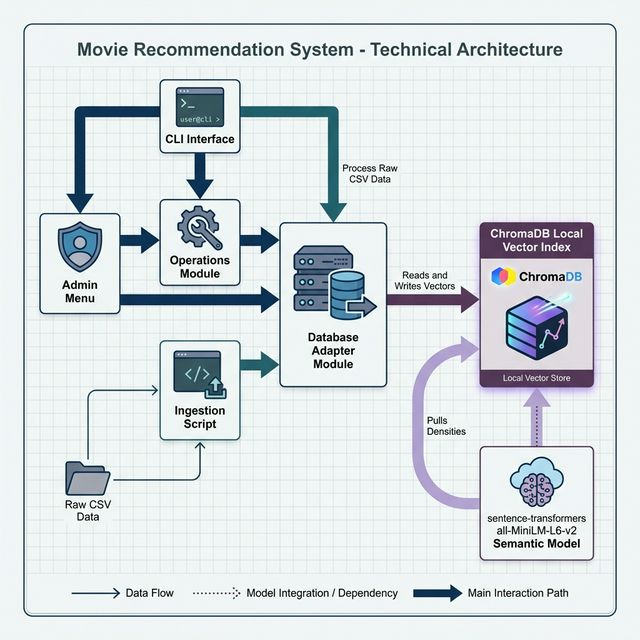

# Component Architecture

The **Movie Recommendation System** adheres to a highly decoupled and modular layout, structured around a Python-based core interacting seamlessly with a persistent local vector store.

## 🧱 Component Breakdown

1. **Frontend (CLI Layer)**  
   - Handled primarily by `main.py`.
   - Utilizes `rich` for visually appealing formatting (tables, panels, spinners) and `questionary` for interactive prompts.
   - Isolates user interactions from core business logic, enabling easy swapping to an HTTP API layer in the future.

2. **Operations Service (Business Logic)**  
   - Handled by `operations.py` and `admin.py`.
   - Bridges the gap between the UI input and database logic.
   - Computes dynamic calculations, prepares UI display attributes (like formatting similarity distances into percentages), handles filtering rule interpretation, and oversees administration functions (database peeking, CRUD operations).

3. **Database Adaptation Module**  
   - Governed by `database.py`.
   - Abstracts all ChromaDB SDK operations (connecting to persistent client, counting, fetching, querying, updating, deleting).
   - Standardizes the response types handed off to the Operations Service, protecting higher layers from breaking changes in potential database dependencies.

4. **Vector Database (ChromaDB)**  
   - A local, persistent store located at `./movie_db`.
   - Holds the HNSW vector indices, string text representations (documents), and specific structured fields (metadata) for filtering.

5. **ML Ingestion & Pipeline Engine**  
   - Covered natively by `ingest_data.py` operations mapping to ChromaDB default behavior.
   - Handles the load of tabular CSVs to Pandas, cleans data (handling missing objects, JSON list unpacking), formats "Rich Documents", and dispatches batches of texts to the vector model `all-MiniLM-L6-v2` for dense embedding calculations.

## 🗺️ System Architecture Diagram

Below is the modular layout overview mapping the core dependencies and runtime flows.

## 🌊 Data Flow Explanation

1. **Ingestion Flow (Initialization)**
   - **Source:** Pre-existing datasets `tmdb_5000_movies.csv` and `tmdb_5000_credits.csv` sit locally.
   - **Processing:** `ingest_data.py` merges these dataframes mapped on `movie_id`. Nested JSON arrays inside 'genres', 'cast', and 'crew' columns are safely parsed using Python's `ast.literal_eval`.
   - **Document Generation:** The data transforms into concatenated strings such as *"Title: The Matrix. Overview: A computer hacker... Genres: Action, Sci-Fi. Cast: Keanu Reeves... Director: The Wachowskis."*
   - **Vector Creation:** The string chunks and their deterministic metadata counterparts pass collectively via `chromadb.add()` batching. The internal sentence-transformer calculates a 384-dimensional vector, linking it persistently in the `movie_db` store.

2. **Recommendation & Semantic Querying Flow**
   - **Input:** User submits a prompt (e.g., *"Action movie with explosions"* via `main.py`).
   - **Processing:** The input prompt string routes to `operations.py`, which triggers `database.query_movies`.
   - **Vector Search:** ChromaDB dynamically vectorizes the user's string in real-time, maps it to the 384-dimensional space, and uses HNSW to fetch nearest neighbor vectors based on calculated Cosine Similarity (or L2/IP metrics).
   - **Output:** The matched subset maps IDs back to human-readable metadata, which `operations.py` formats into an engaging visual table output for terminal rendering.
