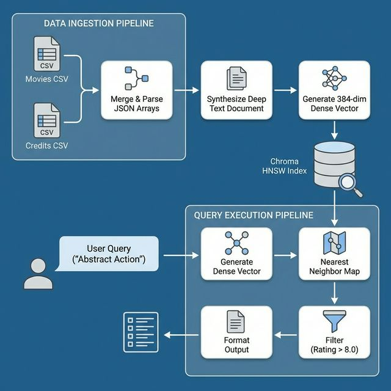

# Data Pipeline Architecture

The ingestion pipeline is designed to transform raw tabular metadata into highly descriptive structural text objects. This enables vector models to accurately generate embedded spatial semantics.

## 📥 Data Sources

The primary data comes from two Kaggle datasets:
1. `tmdb_5000_movies.csv` - Contains movie revenues, overviews, ratings, release dates.
2. `tmdb_5000_credits.csv` - Contains detailed cast and crew credits in JSON formats.

## 🧹 Cleaning & Pre-processing

The `ingest_data.py` pipeline utilizes Pandas to handle pre-processing:
1. **Column Renaming & Merging**: Joins the two CSV files natively using `movie_id`.
2. **Missing Data Handling**: Drops rows missing essential columns like `overview` and `title_x` safely avoiding `NaN` vector injections.
3. **JSON Parsing Resilience**: Utilizes `ast.literal_eval` to extract dictionaries safely.
   - Extracts a flat list of actual genres.
   - Extracts top 5 billed actors to curb noise (`cast_list`).
   - Parses the `crew` dictionary iterating job assignments to isolate only the `"Director"`.

## ✨ Feature Extraction & Rich Document Synthesis

A major challenge in semantic search across tabular datasets is maintaining context. To resolve this, a "Rich Document" function dynamically builds detailed narrative representations of each row instead of vectorizing raw JSON.

**Example Input Node:**
```json
{
  "title": "The Dark Knight",
  "overview": "Batman raises the stakes in his war on crime.",
  "genres": ["Drama", "Action", "Crime", "Thriller"],
  "cast": ["Christian Bale", "Heath Ledger", "Aaron Eckhart", "Michael Caine", "Maggie Gyllenhaal"],
  "director": "Christopher Nolan"
}
```

**Rich Document Output:**
> "Title: The Dark Knight. Overview: Batman raises the stakes in his war on crime. Genres: Drama, Action, Crime, Thriller. Cast: Christian Bale, Heath Ledger, Aaron Eckhart, Michael Caine, Maggie Gyllenhaal. Director: Christopher Nolan."

This unified string forms the embedding baseline.

## 🗄️ Embedding Generation and ChromaDB Storage

1. **Batch Assembly**: The resulting texts (`documents`) alongside discrete values (`metadatas`) and unique string identifiers (`ids`) are bundled into batches of `500`.
2. **Dense Vector Creation**: During `collection.add(...)`, ChromaDB uses the locally fetched sentence-transformer (`all-MiniLM-L6-v2`) to turn each string into a floating-point array (a 384-dimensional dense vector).
3. **Indexing**: The arrays map into an HNSW hierarchical graph located inside the persistent `./movie_db`.

## 🌊 Pipeline Mermaid Diagram


