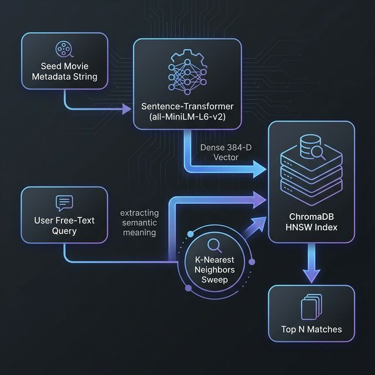

# Machine Learning Vector Model

The Movie Recommendation System shifts away from traditional Collaborative Filtering (Matrix Factorization) to leverage **Content-Based Semantic Search** powered by deep metric learning and dense textual representations.

## 🤖 Model Used: `all-MiniLM-L6-v2`

The system implicitly uses `sentence-transformers/all-MiniLM-L6-v2` as the backing transformer model wrapped by ChromaDB.
- **Architecture**: A smaller, highly-distilled 6-layer version of BERT architecture trained on 1B+ sentences.
- **Dimensionality**: Maps text into a `384`-dimensional dense vector space.
- **Speed**: Optimized for real-time embedding generation (~5x faster than standard BERT equivalents with minimum accuracy dropoff).

## 🧮 How Recommendations Are Generated

The framework doesn't structurally "learn" user viewing preferences over epochs. Instead, it places movies near each other conceptually within high-dimensional space relying on geometric proximity.

1. **Seed Movie Anchor**: When a user queries a recommendation seed (e.g., *Inception*), the query function fetches the exact stored 384D embedding pre-computed during ingestion.
2. **Semantic Matching**: It executes `collection.query()`, evaluating the spatial proximity of the *Inception* vector against all 4800+ existing movie vectors globally.
3. **Sorting**: K-Nearest Neighbors (KNN) are ranked efficiently. Recommendations presented to the user are quite literally the closest data points.

## 📐 Vector Similarity Context Logic

Similarity matching supports three algorithmic toggles dictatable strictly at indexing generation (`admin.py > Interactive Indexing Benchmark`):

- **Cosine Distance (Default):**
  - Measures the angular relation between vectors.
  - Recommended for textual NLP as the magnitude (text length) holds less variance than context flow.
  - Formula interpretation: `Similarity = 1 - (distance / 2)` mapping values to a `0%-100%` confidence metric.
- **L2 Euclidean Distance:**
  - Measures strict physical straight-line point-to-point geometric distance length scaling `[0, ∞]`.
  - Interpreted via exponential decay function `e^(-distance/2)` for UI compatibility logic.
- **Inner Product (`ip`):**
  - Dot product representation optimized for strictly normalized embeddings.

## 🎛️ Training, Hyperparameters & Tuning Insights

Because the system leans on a zero-shot representation transformer, standard "epoch training" and "loss calculation" cycles are bypassed. 

However, tuning directly interfaces with the **HNSW Graph Settings** in ChromaDB:
- **`M` (16 default)**: Dictates node bi-directional links per layer. Increasing this expands memory footprint but heightens recall accuracy.
- **`ef_construction` (100 default)**: The scope of search checking during the index building phase. Higher metrics create a tighter graph.
- **`ef_search` (10 default)**: Search depth scaling speed vs precision bounds during runtime query sweeps.

## 📦 Model Persistence

Embeddings generated are intrinsically persistent inside `./movie_db`. They load seamlessly to CPU/RAM environments on boot without instantiating massive Torch workflows overheads, acting identical to standard relational databases natively.

## 🗺️ Pipeline Diagram

